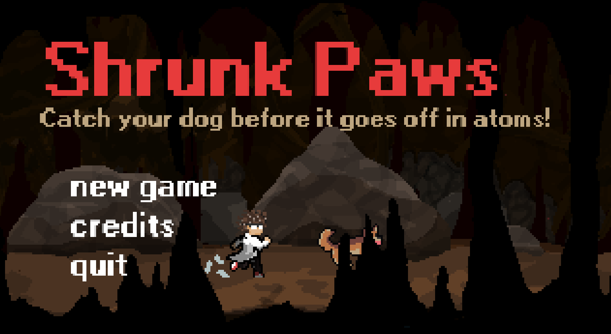

<!-- Improved compatibility of back to top link: See: https://github.com/othneildrew/Best-README-Template/pull/73 -->
<a id="readme-top"></a>

<!-- PROJECT SHIELDS -->
[![Contributors][contributors-shield]][contributors-url]
[![Forks][forks-shield]][forks-url]
[![Stargazers][stars-shield]][stars-url]
[![Issues][issues-shield]][issues-url]
[![LinkedIn][linkedin-shield]][linkedin-url]

<!-- PROJECT LOGO -->
<br />
<div align="center">
  <a href="https://sishycreates.itch.io/shrunk-paws">
    
  </a>

<h1 align="center">Shrunk Paws</h1>

  <p align="center">
    A one-week jam precision platformer: chase your shrinking dog through a giant laboratory before it vanishes below atomic scale.
    <br />
    <br />
    <a href="https://sishycreates.itch.io/shrunk-paws"><strong>Play on Itch.io »</strong></a>
    &middot;
    <a href="https://github.com/sishy-creates/gamejam-between-atoms">Original Repository</a>
    &middot;
    <a href="https://github.com/CarlinoCalogero/shrunk-paws/issues">Report Bug</a>
    &middot;
    <a href="https://github.com/CarlinoCalogero/shrunk-paws/issues">Request Feature</a>
  </p>
</div>

> [!NOTE]
> **Repository Snapshot Notice**:  
> This repository is a snapshot of the project up to my last commit (`827cc19`). The real, original repository of the project developed during **Platformer Jam #2** is available at:  
> **[https://github.com/sishy-creates/gamejam-between-atoms](https://github.com/sishy-creates/gamejam-between-atoms)**

<!-- TABLE OF CONTENTS -->
<details>
  <summary>Table of Contents</summary>
  <ol>
    <li>
      <a href="#about-the-project">About The Project</a>
      <ul>
        <li><a href="#overview--story">Overview & Story</a></li>
        <li><a href="#my-contributions">My Contributions</a></li>
        <li><a href="#core-features--technical-architecture">Core Features & Technical Architecture</a></li>
        <li><a href="#built-with">Built With</a></li>
      </ul>
    </li>
    <li>
      <a href="#getting-started">Getting Started</a>
      <ul>
        <li><a href="#prerequisites">Prerequisites</a></li>
        <li><a href="#installation">Installation</a></li>
      </ul>
    </li>
    <li><a href="#controls--mechanics">Controls & Mechanics</a></li>
    <li><a href="#contributors">Contributors</a></li>
    <li><a href="#contact">Contact</a></li>
    <li><a href="#acknowledgments">Acknowledgments</a></li>
  </ol>
</details>

<!-- ABOUT THE PROJECT -->
## About The Project

**Shrunk Paws** is a fast-paced 2D precision platformer and companion-chase speedrunner created in **Unity 6** for **Platformer Jam #2** across a tight 1-week development window.

### Overview & Story

When a brilliant scientist's experimental shrinking potion is accidentally ingested by his playful dog, the panicked pet shrinks and sprints away deeper into the laboratory.

To save his loyal companion, the scientist consumes the remaining potion and embarks on a frantic chase across a world where everyday lab equipment has become giant and deadly. Players must sprint, double-jump, wall-slide, and air-dash across rapidly shifting scales of reality, avoiding falling hazards and maintaining pace with the autonomous dog. 

> [!IMPORTANT]
> **Keep up with your pet!** If the dog stays off-screen for more than **10 seconds**, it shrinks so much that it becomes smaller than atoms and vanishes, losing the chase forever.

Built under tight jam constraints, the project achieved a polished, highly responsive gameplay feel supported by speedrun timing tools, multi-layered mathematical parallax depth, and handcrafted retro pixel art.

<p align="right">(<a href="#readme-top">back to top</a>)</p>

### My Contributions

As **Gameplay Programmer**, **Pixel Art Artist**, and **Co-Game Designer** in a 6-person team, I contributed extensively to both technical systems and artistic production:

* **Mathematical Parallax Engine**: Engineered the multi-depth camera-relative parallax scrolling system (`Parallax.cs`, `CameraParallax.cs`) with clamped depth normalization and seamless infinite wrapping.
* **Speedrun Timer & Persistence**: Implemented the high-precision millisecond speedrun timer (`GameTimer.cs`) using monospaced TextMeshPro rendering and `PlayerPrefs` record persistence.
* **UI Navigation & Scene Transitions**: Architected the UI navigation and state transition pipeline (`MainMenu.cs`, `PauseMenu.cs`, `SceneTransition.cs`, `CreditsUIBuilder.cs`, `MainMenuCamera.cs`).
* **Custom Unity Editor QA Tooling**: Built editor extensions (`PlayerPrefsResetter.cs`) providing instant top-bar tools for testing clean user states and speedrun records.
* **2D Kinematic Controller**: Co-engineered the responsive platformer character controller (`PlayerController.cs`) with variable jump cuts, wall slides, wall jumps, and an air-dash coroutine.
* **Reactive Physics Hazards**: Co-programmed interactive environmental traps (dropping chemical flasks, lingering toxic gas clouds, rolling test tubes, and slip hazards).
* **2D Pixel Art & Environments**: Handcrafted pixel art sprites for the scientist protagonist, run/jump animation cycles, autotiled modular laboratory tilesets, and environmental hazard assets.

<p align="right">(<a href="#readme-top">back to top</a>)</p>

### Core Features & Technical Architecture

#### 1. Multi-Layer Clamped Parallax Engine
Mathematical camera-relative parallax scrolling system (`Parallax.cs`, `CameraParallax.cs`) creating 2.5D depth across the macroscopic laboratory. Normalizes positive Z depths against the camera far clip plane with `Mathf.Clamp01` to strictly prevent distant layers from outrunning the camera, while applying seamless coordinate wrapping to eliminate visual clipping.

#### 2. Precision Speedrun Timer System
High-frequency millisecond timer (`GameTimer.cs`) using monospaced TextMeshPro styling to eliminate horizontal digit jitter during rapid frame updates. Personal best run times are tracked and persisted across sessions via Unity `PlayerPrefs`, displayed on both the in-game HUD and main menu.

#### 3. Menu Flow & Scene Transition Architecture
Comprehensive UI state pipeline (`MainMenu.cs`, `PauseMenu.cs`, `SceneTransition.cs`, `CreditsUIBuilder.cs`) handling smooth camera pans between menu panels, timescale-safe in-game pause suspension, dynamic credits generation, and seamless scene cross-fades during game-over and restarts.

#### 4. Custom Unity Editor Tooling
Top-bar Unity Editor extensions (`PlayerPrefsResetter.cs`) exposing dedicated one-click actions (`Tools -> Reset Best Time` and `Tools -> Clear ALL PlayerPrefs`) for rapid QA testing of clean-state user flows and record persistence without manual registry editing.

#### 5. Kinematic 2D Character Controller
Responsive platformer controller (`PlayerController.cs`) tuned for speedrun game-feel, featuring variable-height jump cuts (`jumpCutMultiplier = 0.5f`), friction-damped wall-sliding with collision grace windows, a zero-gravity invulnerable air-dash coroutine, and dynamic speed/jump status modifiers for environmental traps.

#### 6. Reactive Physics Hazards & Traps
Interactive environmental hazards reacting to physics: proximity-triggered overhead flasks that shatter into speed-reducing toxic gas clouds (`FallingPotion.cs`, `GasCloud.cs`), slope-rolling test tubes (`RollingSystem.cs`), and organic slip hazards (`DogPoop.cs`).

#### 7. 2D Pixel Art & Environment Design
Handcrafted retro pixel art including scientist protagonist character sprites, running/jumping animation cycles, modular laboratory tilesets configured with Unity Rule Tile autotiling, and layered parallax background vistas.

<p align="right">(<a href="#readme-top">back to top</a>)</p>

### Built With

* [![Unity][Unity-badge]][Unity-url]
* [![C#][CSharp-badge]][CSharp-url]
* [![FMOD][FMOD-badge]][FMOD-url]
* [![Itch.io][Itch-badge]][Itch-url]

<p align="right">(<a href="#readme-top">back to top</a>)</p>

<!-- GETTING STARTED -->
## Getting Started

To explore the source code locally or run the project in the Unity Editor:

### Prerequisites

* **Unity Hub**: Recommended for managing Unity versions.
* **Unity 6**: Version `6000.3.16f1` (or compatible Unity 6 release).
* **Git**: To clone the repository.

### Installation

1. Clone the repository:
   ```sh
   git clone https://github.com/CarlinoCalogero/shrunk-paws.git
   ```
2. Open **Unity Hub**.
3. Click **Add** &gt; **Add project from disk** and choose the cloned repository directory.
4. Select **Unity Editor 6000.3.16f1** as the editor version.
5. Launch the project (Unity will automatically import and resolve package dependencies including Input System, TextMeshPro, FMOD Studio Integration, and 2D Tilemap).
6. In the Unity Project window, open the starting scene:
   ```
   Assets/_Project/Scenes/Main Menu.unity
   ```
7. Press **Play** in the Unity Editor toolbar to run the game.

<p align="right">(<a href="#readme-top">back to top</a>)</p>

<!-- CONTROLS & MECHANICS -->
## Controls & Mechanics

| Action | Primary Input (Keyboard) | Details |
| :--- | :--- | :--- |
| **Move Left / Right** | `A` / `D` or `Arrow Keys` | Horizontal locomotion |
| **Sprint** | `Left Shift` | Increases movement velocity while grounded |
| **Jump** | `Space` | Variable jump height (release early for a low hop) |
| **Double Jump** | `Space` (in mid-air) | Secondary mid-air impulse |
| **Wall Slide & Jump** | `Space` against wall | Slides down vertical surfaces and launches diagonal kick |
| **Air Dash** | `F` (when unlocked) | Propels forward through obstacles with temporary invulnerability |
| **Pause Game** | `Escape` | Toggles the in-game pause menu |

<p align="right">(<a href="#readme-top">back to top</a>)</p>

<!-- CONTRIBUTORS -->
## Contributors

This repository is an archived game jam showcase snapshot and is not currently accepting external contributions or pull requests. 

A special thank you to everyone who contributed to the project during development:

<a href="https://github.com/CarlinoCalogero/shrunk-paws/graphs/contributors">
  
</a>

<p align="right">(<a href="#readme-top">back to top</a>)</p>

<!-- CONTACT -->
## Contact

**Calogero Carlino** - Gameplay, Systems & Tools Programmer  
* **Portfolio**: [https://carlinocalogero.github.io](https://carlinocalogero.github.io)  
* **Email**: [carlinocalogero.dev@gmail.com](mailto:carlinocalogero.dev@gmail.com)  
* **LinkedIn**: [https://www.linkedin.com/in/calogero-carlino-2a94a33b5/](https://www.linkedin.com/in/calogero-carlino-2a94a33b5/)  
* **GitHub**: [https://github.com/CarlinoCalogero](https://github.com/CarlinoCalogero)  

**Project Link**: [https://github.com/CarlinoCalogero/shrunk-paws](https://github.com/CarlinoCalogero/shrunk-paws)  
**Original Repository**: [https://github.com/sishy-creates/gamejam-between-atoms](https://github.com/sishy-creates/gamejam-between-atoms)  
**Play on Itch.io**: [https://sishycreates.itch.io/shrunk-paws](https://sishycreates.itch.io/shrunk-paws)  

<p align="right">(<a href="#readme-top">back to top</a>)</p>

<!-- ACKNOWLEDGMENTS -->
## Acknowledgments

* **Platformer Jam #2** for the theme and hosting the game jam.
* **Game Jam Team Members**:
  * **Game Design**: Calogero Carlino & Filippo
  * **Programming**: Silvia, Matteo, Calogero Carlino, Filippo, Antonio, Alessandro
  * **Art**: Calogero Carlino & Antonio
  * **Audio**: Alessandro
* **FMOD Studio** for adaptive audio middleware integration.
* **Best-README-Template** by [othneildrew](https://github.com/othneildrew/Best-README-Template) for the template structure.

<p align="right">(<a href="#readme-top">back to top</a>)</p>

<!-- MARKDOWN LINKS & IMAGES -->
[contributors-shield]: https://img.shields.io/github/contributors/CarlinoCalogero/shrunk-paws.svg?style=for-the-badge
[contributors-url]: https://github.com/CarlinoCalogero/shrunk-paws/graphs/contributors
[forks-shield]: https://img.shields.io/github/forks/CarlinoCalogero/shrunk-paws.svg?style=for-the-badge
[forks-url]: https://github.com/CarlinoCalogero/shrunk-paws/network/members
[stars-shield]: https://img.shields.io/github/stars/CarlinoCalogero/shrunk-paws.svg?style=for-the-badge
[stars-url]: https://github.com/CarlinoCalogero/shrunk-paws/stargazers
[issues-shield]: https://img.shields.io/github/issues/CarlinoCalogero/shrunk-paws.svg?style=for-the-badge
[issues-url]: https://github.com/CarlinoCalogero/shrunk-paws/issues
[linkedin-shield]: https://img.shields.io/badge/-LinkedIn-black.svg?style=for-the-badge&logo=linkedin&colorB=555
[linkedin-url]: https://www.linkedin.com/in/calogero-carlino-2a94a33b5/

[Unity-badge]: https://img.shields.io/badge/Unity_6-000000?style=for-the-badge&logo=unity&logoColor=white
[Unity-url]: https://unity.com/
[CSharp-badge]: https://img.shields.io/badge/C%23-239120?style=for-the-badge&logo=c-sharp&logoColor=white
[CSharp-url]: https://learn.microsoft.com/en-us/dotnet/csharp/
[FMOD-badge]: https://img.shields.io/badge/FMOD-000000?style=for-the-badge&logo=fmod&logoColor=white
[FMOD-url]: https://fmod.com/
[Itch-badge]: https://img.shields.io/badge/Itch.io-FA5C5C?style=for-the-badge&logo=itchdotio&logoColor=white
[Itch-url]: https://sishycreates.itch.io/shrunk-paws
